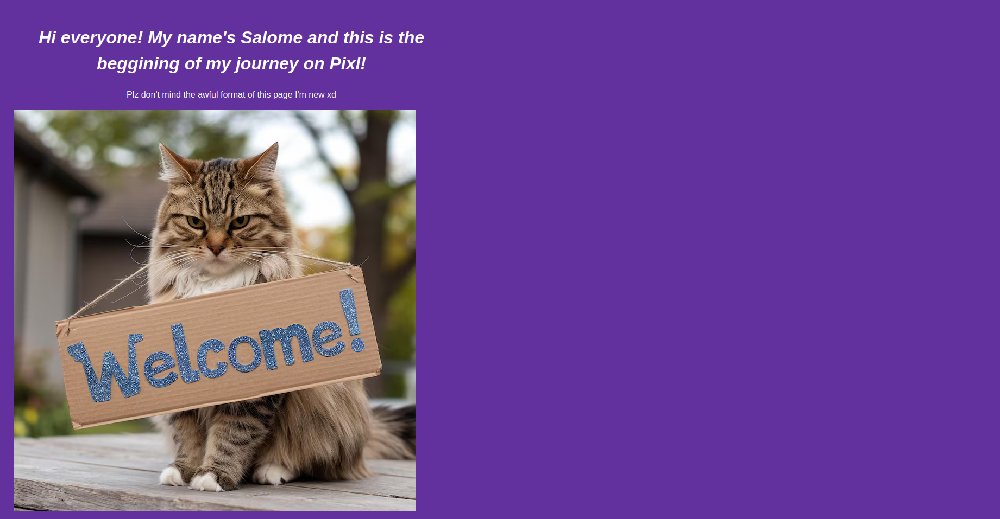

# salos-builder-page



## Introduction

As I take my first steps into Hackclub's "Pixl" workflow, I am now called to create a small HTML page/file introducing myself to the project community community.

I made this small HTML page to complete the 'Raise your builder page' trial on Pixl, a Hack Club's program.
Hack Club is a 501(c)(3) nonprofit and network of 100k+ technical high schoolers. (Added this in case anyone outside Hack club sees this :p)


```
## Files on the project

salos-builder-page/
|-- index.html
|--style.css
```

### File description

'index.html' contains the main structure of the page, that means it defines the sections that it has (where i wrote things like my hobbies or som of my information) and things like the tab title and such

'style.css' defines the properties that some things will have when called on the main html file, for example, the file says that the letters of an h1 title will have a color dependind on the hexcode written in the file, being in this case just plain white

Pro tip: you can visit a page called HTML color codes to see the hexcode of the color you want to change in the page, here's the link:
https://htmlcolorcodes.com/

## How to see this page

If you are reviewing this submission you can either make use of the provided link to github pages to see it deplyed or you can just click the link on the right side of this repo to check it out

I think you can also download locally and run it on your web browser by using VScode or the editor you want to use (I think editor is the word for it, but I'm not sure)

As I mentioned before in the 'style.css' definition, you can change the colors that each individual thing has, like the color of some letters and titles, boxes and even the background color of the whole page

## Languages used in this project (I saw this on various readme's so I think it could be good to put it here)
HTML5
CSS3

Yeah there isn't anything very much beyond what I defined earlier

##Author
This project was made by Salome (@Starlady.salo in slack) as a submission for Hack Club.


